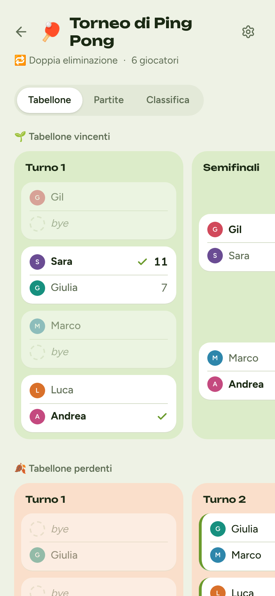
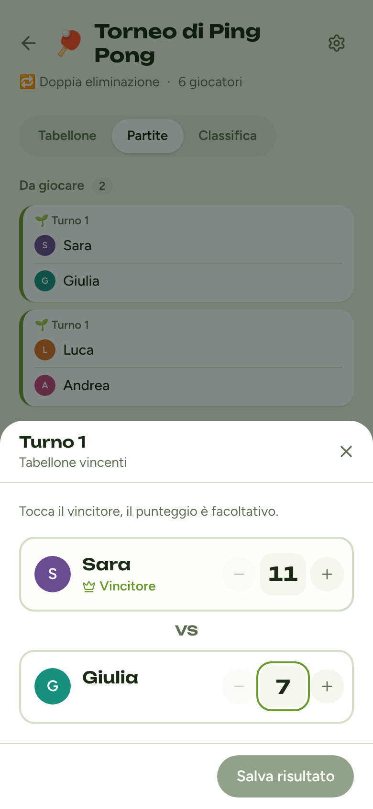
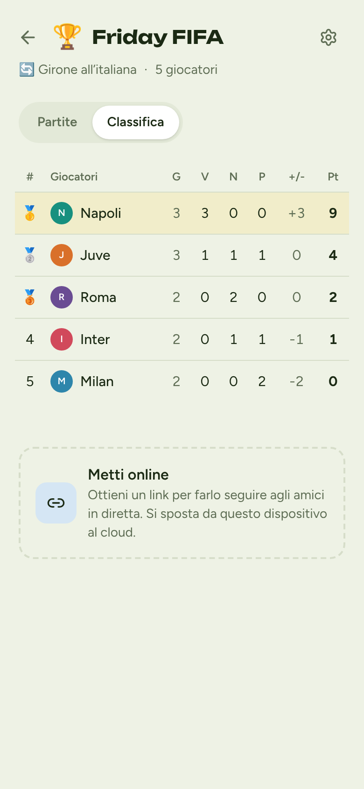

<p align="center"></p>

<h1 align="center">Matcha</h1>

<p align="center">
  Tournaments with friends. Knockout, double elimination or round robin.<br>
  Make the bracket, share the link, play. In Italian and English.
</p>

<p align="center"><b><a href="https://g1lg1l.github.io/matcha/">Open Matcha</a></b> · a sibling of <a href="https://github.com/g1lg1l/midori">Midori</a> 🍵</p>

<p align="center">
  
  
  
  
</p>

## What it does

- **Three formats**
  - **Knockout** (single elimination), with an optional 3rd place match.
  - **Double elimination**: lose once and you drop to the losers bracket, lose twice and you're out. Grand final with an optional reset, so the losers-bracket player has to beat the winners-bracket player twice.
  - **Round robin** (girone all'italiana): everyone plays everyone, once or home and away. 3 points for a win, 1 for a draw. Ties are broken by score difference, then points scored, then head to head.
- **Any number of players**, from 2 to 128. Byes go to the top seeds. The list order is the seeding (#1 and #2 only meet in the final), or you can shuffle it. Paste a list to add everyone at once.
- **Results in two taps.** Tap the winner, add scores if you like. Fix an old result and the bracket re-flows: later matches that no longer make sense reset by themselves.
- **On your device or online.**
  - *On this device*: saved locally, works offline, no account.
  - *Online*: saved in Supabase. Share the link and friends follow live. A local tournament can be put online at any time.
- **Referee link.** Online, the organiser can send a second link. Whoever opens it can enter results and edit the tournament, but can't delete it. It's also how you run your tournament from your other devices. Results are saved one at a time on the server, so two referees entering different matches never overwrite each other. The organiser can make a new referee link at any time, and the old one stops working.
- **Italian and English**, picked from the device language, switchable anytime.
- **Playful, like Midori**: same palette steeped towards matcha, Unbounded and Figtree, sheets that slide up, emoji confetti and a wobbling trophy for the champion. Light and dark themes.
- **Web, Android and iOS** from one codebase. On the web it's also installable as an app.

<p align="center"></p>

## Stack

React, Vite, TypeScript and Tailwind. Capacitor wraps the same build into the Android and iOS apps. Supabase (anonymous auth, Postgres with RLS, Realtime) handles online tournaments. It's the same Supabase project as Midori, and every table and function is prefixed `matcha_`.

The bracket logic lives in [`src/engine.ts`](src/engine.ts). It's pure TypeScript with tests in [`src/engine.test.ts`](src/engine.test.ts). A tournament stores only its settings, players and results. Everything else (who plays whom, standings, champion) is rebuilt from those, which is why corrections just work.

## Run it

```bash
npm install
npm run dev        # http://localhost:5173
npm test           # bracket engine tests
npm run build
```

`.env` holds the public Supabase URL and publishable key. These values ship to the browser anyway.

### Online tournaments: one-time setup

Open the Supabase dashboard, go to the SQL Editor, paste [`supabase/matcha.sql`](supabase/matcha.sql) and run it. It creates only `matcha_*` objects. It's safe to run again, including over an older version, so do the same after every schema change. Anonymous sign-ins must be enabled. They already are, because Midori uses them.

Roles: the **owner** created the tournament; an **editor** opened the referee link; a **viewer** opened the share link. Row-level security enforces this, not just the UI. [`supabase/tests/run.sh`](supabase/tests/run.sh) checks it on a local Postgres with a small Supabase stand-in.

### Android and iOS

```bash
npm run android    # builds, syncs, opens Android Studio
npm run ios        # builds, syncs, opens Xcode (macOS)
```

After any web change, `npm run cap:sync` copies the new build into both apps. Icons and splash screens come from `public/favicon.svg`: `NODE_PATH=$(npm root -g) node scripts/icons.mjs`.

### Deploy

Pushing to `main` runs the tests and publishes to GitHub Pages (Settings → Pages → Source: GitHub Actions).
