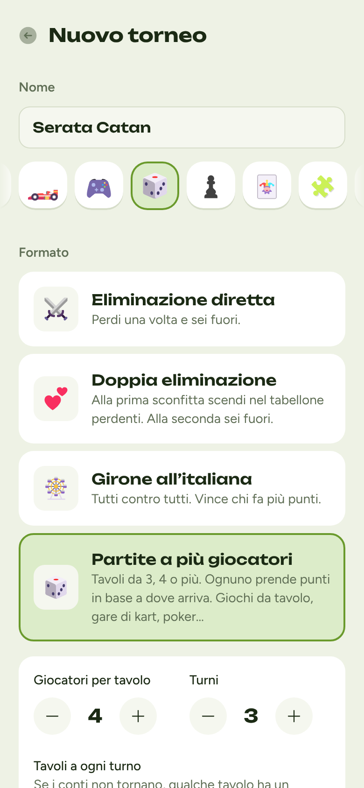
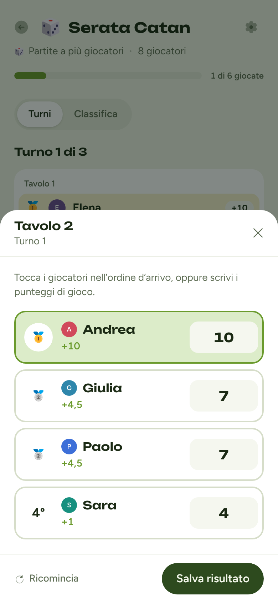
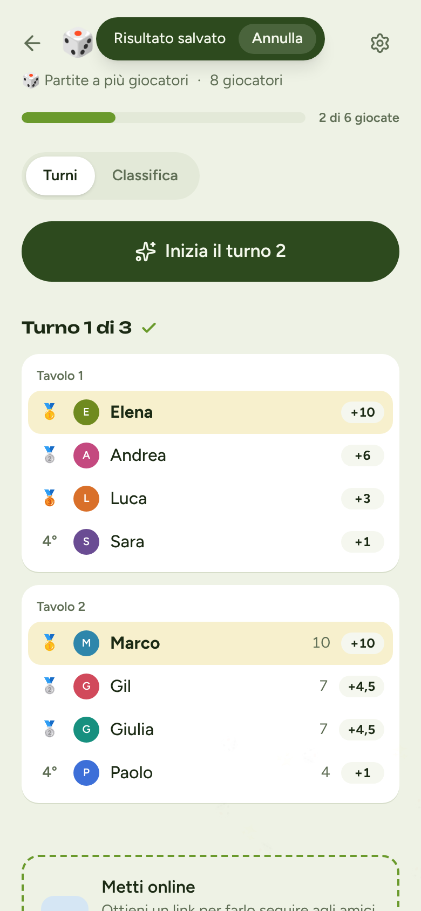
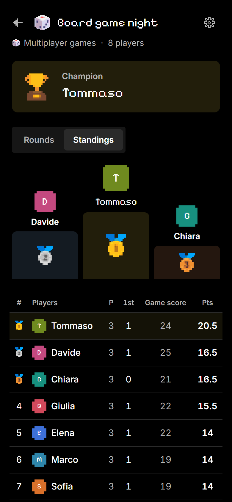
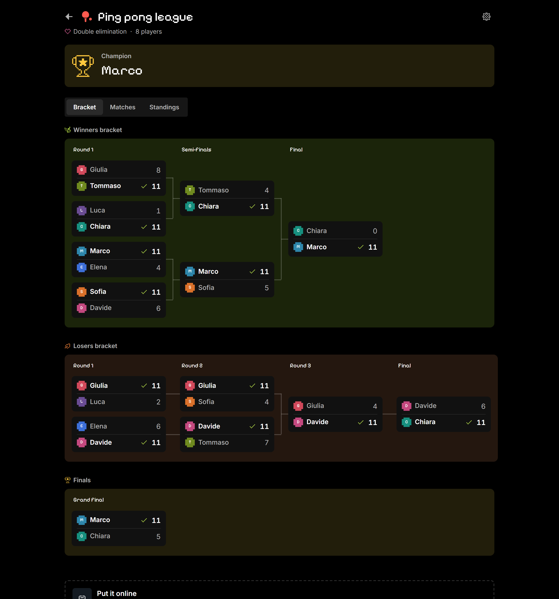

<p align="center"></p>

<h1 align="center">Matcha</h1>

<p align="center">
  Tournaments with friends. Knockout, double elimination, round robin, rotating partners<br>or multiplayer games where everyone scores by where they finish. Or just a scoreboard.<br>
  Make the bracket, share the link, play. In Italian and English.
</p>

<p align="center"><b><a href="https://g1lg1l.github.io/matcha/">Open Matcha</a></b> · a sibling of <a href="https://github.com/g1lg1l/midori">Midori</a> 🍵</p>

<p align="center">
  
  
  
  
</p>

## What it does

- **Five formats**
  - **Knockout** (single elimination), with an optional 3rd place match.
  - **Double elimination**: lose once and you drop to the losers bracket, lose twice and you're out. Grand final with an optional reset, so the losers-bracket player has to beat the winners-bracket player twice.
  - **Round robin** (girone all'italiana): everyone plays everyone, once or home and away. Points per win, draw and loss are up to you: 3·1·0 like football, 1·½·0 like chess, or anything else. Ties are broken by score difference, then points scored, then head to head.
  - **Rotating partners** (the Italian *torneo giallo*): everyone signs up alone and plays two against two with a new partner every match, once with everyone else. The matches are made for you. Ranked by wins, then points scored, then fewest points conceded. It comes out exact with 4, 8, 12, 16 players (or one more); with other counts one pair never forms.
  - **Multiplayer games**: for board games, kart races, poker and the like. Each round seats everyone at tables of 2 to 8 players.
    - **Points by finishing place**: pick a preset (10·6·3·1, 3·2·1·0…) or type your own. Tied players share the points of the places they cover.
    - **Game scores (optional)**: type victory points, chips or strokes and the finishing order follows. Standings can go by place points or by total game score, with "lowest wins" for golf and the like.
    - **Seating**: random every round, or by standings so leaders play leaders. At tables of two it avoids rematches when it can.
    - **BIG rulebook** ([Board Italian Gamers](https://boarditaliangamers.it)): a points preset with 1000 for 1st place and the rest by table size (2 to 7 players), and its tie-breaks: share of the table's score after round 1, then whoever played at the higher table.
- **Just a scoreboard.** From the home page, no tournament needed: a card per player, plus and minus, a keypad for bigger jumps.
- **Timers.** One countdown for the round or the match being played, and one of its own for every match or table. They ring when time is up and keep the screen on.
- **Any number of players**, from 2 to 128. Byes go to the top seeds. The list order is the seeding (#1 and #2 only meet in the final), or you can shuffle it. Paste a list to add everyone at once.
- **Results in two taps.** Tap the winner, add scores if you like. Fix an old result and the bracket re-flows: later matches that no longer make sense reset by themselves. Every result can be undone for a few seconds, including what it reset.
- **On your device or online.**
  - *On this device*: saved locally, works offline, no account.
  - *Online*: saved in Supabase. Share the link and friends follow live. A local tournament can be put online at any time.
- **Referee link.** Online, the organiser can send a second link. Whoever opens it can enter results and edit the tournament, but can't delete it. It's also how you run your tournament from your other devices. Results are saved one at a time on the server, so two referees entering different matches never overwrite each other. The organiser can make a new referee link at any time, and the old one stops working.
- **Italian and English**, picked from the device language, switchable anytime.
- **Night arcade look**: true black, one matcha lime on the action and the data, Inter for reading and Pixelify Sans for names and scores. Trophies, medals and sports are pixel-art icons, buttons have pixel-cut corners, and the champion gets pixel-icon confetti and a wobbling trophy. Brackets are drawn with joining lines, standings end on a podium, and a progress bar shows how far along you are. A light vibration on phones.
- **Play again**: start a new tournament with the same players and rules in one tap.
- **Web, Android and iOS** from one codebase. On the web it's also installable as an app.

<p align="center"></p>

## Stack

React, Vite, TypeScript and Tailwind. Icons come from Iconify, bundled at build time so they work offline: Pixelarticons and Streamline Pixel for the pixel-art look, Material Design Icons for the sports no pixel set draws, and medals drawn as pixel badges. No emoji anywhere, so it looks the same on every device. Capacitor wraps the same build into the Android and iOS apps. Supabase (anonymous auth, Postgres with RLS, Realtime) handles online tournaments. It's the same Supabase project as Midori, and every table and function is prefixed `matcha_`.

The tournament logic lives in [`src/engine.ts`](src/engine.ts) and [`src/party.ts`](src/party.ts). It's pure TypeScript, tested in the matching `.test.ts` files. A tournament stores only its settings, players and results. Everything else (who plays whom, standings, champion) is rebuilt from those, which is why corrections just work.

## Run it

```bash
npm install
npm run dev        # http://localhost:5173
npm test           # bracket engine tests
npm run build
```

`.env` holds the public Supabase URL and publishable key. These values ship to the browser anyway.

### Online tournaments: one-time setup

Open the Supabase dashboard, go to the SQL Editor, paste [`supabase/matcha.sql`](supabase/matcha.sql) and run it. It creates only `matcha_*` objects. It's safe to run again, including over an older version, so do the same after every schema change. Anonymous sign-ins must be enabled. They already are, because Midori uses them.

Roles: the **owner** created the tournament; an **editor** opened the referee link; a **viewer** opened the share link. Row-level security enforces this, not just the UI. [`supabase/tests/run.sh`](supabase/tests/run.sh) checks it on a local Postgres with a small Supabase stand-in.

### Android and iOS

```bash
npm run android    # builds, syncs, opens Android Studio
npm run ios        # builds, syncs, opens Xcode (macOS)
```

After any web change, `npm run cap:sync` copies the new build into both apps. Icons and splash screens come from `public/favicon.svg`: `NODE_PATH=$(npm root -g) node scripts/icons.mjs`.

### Deploy

Every push to `main` is linted, tested and built ([`ci.yml`](.github/workflows/ci.yml)); nothing is published.

A release is a tag. Set the version in `package.json` (the app shows it in Settings), commit, then:

```bash
git tag v0.2.0 && git push origin v0.2.0
```

[`release.yml`](.github/workflows/release.yml) then tests and publishes the site to GitHub Pages (Settings → Pages → Source: GitHub Actions), builds `matcha.apk` and attaches it to a GitHub release with notes from the commits since the last one. The tag must match `package.json`.

The APK is signed with the debug key. To have every release install over the last one, give the repository the secret `ANDROID_DEBUG_KEYSTORE`: one `debug.keystore`, base64 encoded. Without it each release is signed with a key of its own.
